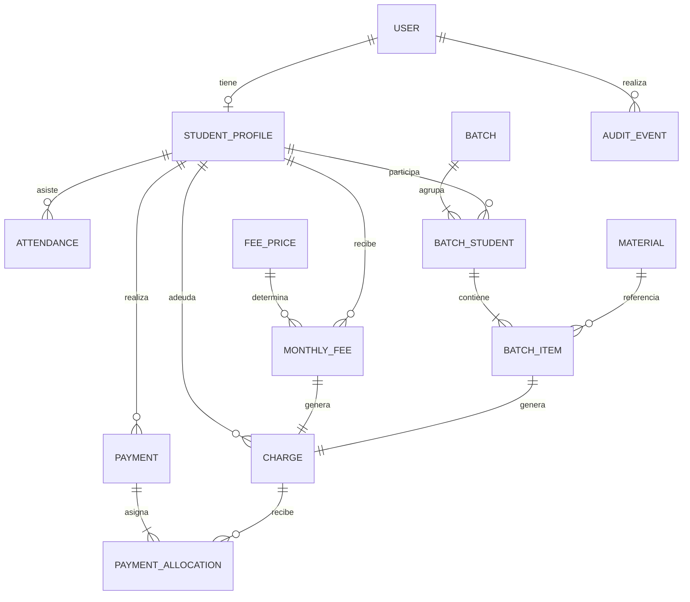

# Arquitectura inicial de SUYAI

Estado: propuesta inicial; todavía no hay aplicación ni base de datos implementadas.

## Plataforma y organización

Se propone Next.js con TypeScript y PostgreSQL, con Prisma para acceso y migraciones; la versión estable y el proveedor de sesiones se verificarán durante la instalación. Separar interfaz (`app/`, `components/`), servicios de aplicación (`src/services/`), reglas puras (`src/domain/`), persistencia (`src/data/`), autenticación/autorización y auditoría. El servidor verifica identidad y permisos en cada lectura y mutación; los identificadores del cliente nunca conceden acceso. No hay registro público. El primer administrador se creará mediante un procedimiento de instalación interactivo, sin credenciales persistidas en código.

## Modelo conceptual

La implementación debe distinguir registros de horno y materiales y garantizar que cada cargo y asignación pertenezcan a la misma alumna mediante restricciones de base de datos. Las cuotas son únicas por alumna y período; el historial de precios es efectivo por período. Una baja lógica conserva historial y permite acceso de la alumna; la elegibilidad para cada período debe persistirse al alta/reactivación. Los borradores no crean cargos.

## Economía e integridad

Cada cargo conserva el importe original y sus correcciones auditadas; su saldo se calcula a partir de asignaciones de pagos vigentes, sin saldos negativos. Los pagos parciales se asignan manualmente a cargos seleccionados. Anular pagos revierte su efecto sin borrar registros. En cada transacción económica se bloquean los cargos afectados en orden estable, se verifica el saldo y se escriben los movimientos y auditoría de forma atómica; las solicitudes llevan clave de idempotencia y huella de contenido. Se aplican restricciones y pruebas de concurrencia en PostgreSQL. Importes en centavos enteros; cantidades con hasta tres decimales y redondeo por línea al centavo, mitad hacia arriba: propuesta técnica pendiente de validación con el negocio. El precio cero requiere motivo o confirmación, y la alumna inactiva confirmación explícita.

La generación de cuotas debe ser reanudable e idempotente, con ejecución periódica persistente, unicidad por período y recuperación tras reinicios. El valor general nuevo rige desde el siguiente período y no modifica cargos existentes. La fecha de vencimiento mensual será configurable.

## Seguridad y operaciones

Sesiones seguras con cookies HttpOnly, Secure en producción y SameSite apropiado; hashing resistente, limitación de intentos persistente, cambio inicial obligatorio y recuperación segura. No registrar secretos ni incluirlos en auditoría. Definir despliegue con TLS, copias cifradas y restauración probada antes de producción. Verificar protección CSRF y XSS según los mecanismos elegidos.

## Orden de implementación

1. Aprobar sistema visual y precisar identidad original y reglas pendientes.
2. Preparar entorno, esquema, migraciones y pruebas de integridad.
3. Implementar acceso, roles y administración de alumnas.
4. Implementar cargos, cuotas y pagos con pruebas transaccionales.
5. Implementar cargas masivas y borradores compartidos, hornos y materiales.
6. Construir paneles y verificar cada pantalla contra mockups aprobados.
7. Completar pruebas integrales, seguridad, respaldo y despliegue.

Las fases económicas deben integrarse sin dejar accesibles operaciones sin sus invariantes; el orden puede ajustar dependencias sin alterar los requisitos.
